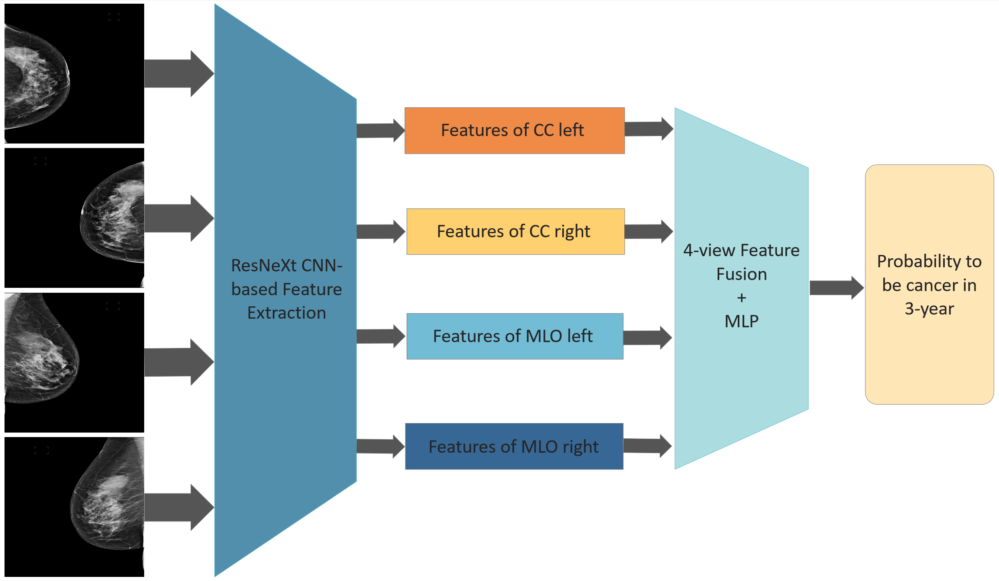

<p align="center">
  <picture>
    <source media="(prefers-color-scheme: dark)" srcset="assets/logo-light.png">
    <source media="(prefers-color-scheme: light)" srcset="assets/logo-dark.png">
    
  </picture>
</p>

# BREST: Breast Risk Evaluation from Screening Test

BREST is an artificial-intelligence model that estimates three-year breast cancer risk from the four standard images of a screening mammogram. It was developed at the University of Warwick with NHS and academic collaborators, using the OPTIMAM Mammography Image Database. The research aims to support risk-adapted breast screening and earlier cancer detection.

We share BREST software and neural networks with the research community to support independent evaluation and further research. This repository provides the preprocessing code, network architecture and inference code; the published v1 weights are available through [Hugging Face](https://huggingface.co/dnamodel/BREST-AI). Access is governed by the [University of Warwick BREST software licence](LICENSE), which permits academic research and non-commercial, non-clinical evaluation.

## Publication

**Wei J, Zhou X, Santeramo R, Al-Attar M, Muthyala S, Gilbert F, Brentnall AR, Montana G. BREST-AI: Three-year breast cancer risk prediction from screening mammograms. *npj Breast Cancer* (2026). [doi:10.1038/s41523-026-01069-x](https://doi.org/10.1038/s41523-026-01069-x).**

Please cite this study when using BREST. This repository implements the model described in that publication.

## Modelling approach

BREST uses a ResNeXt-50 image encoder and Attentional Feature Fusion (AFF) to combine the craniocaudal (CC) and mediolateral oblique (MLO) views from both breasts. Training progresses from annotated lesion patches to full-image cancer detection and risk prediction, followed by fusion of all four views into an examination-level risk score. This curriculum builds on our finding that stronger cancer-detection models can improve risk prediction ([Santeramo et al., 2024](https://doi.org/10.1186/s13058-024-01775-z)).

<p align="center">
  
</p>

## Results

The study evaluated three-year risk discrimination in independent retrospective case–control cohorts, comparing BREST with MIT's Mirai model on the same women. These results use the final 16-bit BREST configuration.

| External validation cohort | Women (cancer cases) | BREST AUC (95% CI) | Mirai AUC (95% CI) |
|---|---:|---:|---:|
| UK, Hologic | 7,596 (1,899) | 0.751 (0.738–0.764) | 0.700 (0.687–0.714) |
| UK, Siemens | 1,600 (400) | 0.719 (0.689–0.748) | 0.685 (0.656–0.715) |
| US, Hologic | 388 (97) | 0.670 (0.609–0.731) | 0.633 (0.570–0.696) |

AUC measures discrimination; CI denotes confidence interval. The smaller US evaluation is exploratory. Use of scores as absolute risks requires calibration to the target screening population.

## Using BREST

### Environment and trained weights

Use Python 3.11 on Linux. Install the inference and preprocessing dependencies, then download the published **BREST v1 16-bit examination-level weights**:

```bash
python -m pip install -r requirements-published-cuda.lock
python scripts/download_weights.py --output-dir models
```

The locked environment pins PyTorch 2.1.0 / CUDA 11.8, Kornia 0.7.1 and their dependencies. Use this same installation for CPU inference with `--device cpu`.

The downloader retrieves `brest-ai-v1.safetensors` from [dnamodel/BREST-AI](https://huggingface.co/dnamodel/BREST-AI) and checks its SHA-256 against [weights_manifest.json](weights_manifest.json). The file contains the complete inference model. Training-state files are not required. The [model card](https://huggingface.co/dnamodel/BREST-AI) describes the release and research-use licence. DICOM conversion requires DCMTK 3.6.7 with PNG support and its `dcmj2pnm` executable on `PATH`.

### Prepare the images

Run commands from the repository root. The preprocessing script converts two-dimensional, for-presentation DICOM mammograms to breast-aligned, 2048 × 2048, 16-bit PNGs and produces breast masks. Its metadata CSV requires `path` (relative to the DICOM root, without the `.dcm` extension) and `ImageLaterality` (`L` or `R`).

```bash
python dataProcessing/dicom_to_png16_2048_background-cleaned.py \
    --csv-file-path /data/image_metadata.csv \
    --dicom-dir /data/dicom \
    --processed-images-dir /data/processed_png \
    --breast-mask-dir /data/breast_masks \
    --max-workers 16 \
    --profile paper-hologic
```

Use `--profile paper-hologic` for the Hologic preparation: 16-bit DICOM rendering followed by Lanczos resizing. To reproduce the paper’s Siemens preparation, use `--profile paper-siemens`: its original 8-bit rendering is expanded to the uint16 range before NumPy bilinear resizing. Both profiles produce 16-bit PNGs and use the original fixed seed of 42 for background cleaning. Image filenames do not affect the generated pixels.

### Run inference

Supply one row per image with `ClientID`, `path`, `ViewPosition` (`CC` or `MLO`) and `ImageLaterality` (`L` or `R`). Paths are relative to the prepared PNG root, with or without `.png`. Include `EpisodeID` when a woman has more than one examination. Each examination must contain all four views; the loader validates and orders them as **left CC, right CC, left MLO, right MLO**. Missing or duplicate views cause an error instead of silently excluding examinations.

The [example CSV](data/test_metadata_example.csv) contains synthetic identifiers and placeholder image paths. Replace them with your own local records. Patient images and clinical records are not distributed with the model.

```bash
python scripts/patientLevel-inference.py \
    --metadata_csv /data/examinations.csv \
    --image_root_dir /data/processed_png \
    --model_checkpoint models/brest-ai-v1.safetensors \
    --final_csv_path /data/output/predictions.csv \
    --gpu_id 0
```

Inference resizes the prepared PNGs to 1792 × 1792, preserves the published 16-bit pixel scaling and normalisation, and saves one score per examination with its supplied identifiers. Add `--device cpu` to run without a GPU. The default batch size is one examination; increase `--batch_size` if memory permits.

For a labelled evaluation, include a consistent `EpisodeOutcome` for each examination. To preserve the original evaluation convention, `N` maps to zero and every other value maps to one. Encode outcomes for the intended cancer-versus-control comparison before running. AUC is reported when both classes are present; add `--roc_plot_path /data/output/roc_curve.png` to save a ROC figure. Labels are optional for prediction. Positive outcomes for a risk evaluation refer to diagnoses during the three-year follow-up after the index mammogram.

To reproduce an original, already ordered v1 evaluation CSV, add `--preserve_row_order`. This explicitly retains the original loader’s four-row order instead of sorting or rejecting historical view tags. Each examination must still contain four existing images. Use the exact input order from the published evaluation when applying this option.

The score is an examination-level risk ranking. Interpreting it as an absolute three-year risk requires calibration to the target population. See [Reproducing the published evaluation](docs/reproducing_paper.md) for the study cohorts, data access, original input ordering and metric calculation.

## Repository contents

| Location | Contents |
|---|---|
| [`dataProcessing/`](dataProcessing/) | DICOM conversion and breast-background processing |
| [`scripts/`](scripts/) | Neural network definitions and examination-level inference |
| [`data/`](data/) | Example metadata and view ordering |
| [`Images/`](Images/) | Model diagrams and research illustrations |
| [`requirements-published-cuda.lock`](requirements-published-cuda.lock) | Pinned inference and preprocessing environment |
| [`weights_manifest.json`](weights_manifest.json) | Published weight identity and SHA-256 checksum |
| [`CITATION.cff`](CITATION.cff) | Machine-readable citation for the published paper |
| [`LICENSE`](LICENSE) | Terms covering the software and neural network weights |

## Team, funding and data

The research is led by Professor Giovanni Montana at the University of Warwick, with collaborators at Queen Mary University of London, the University of Cambridge, University Hospitals of Leicester and University Hospitals Coventry and Warwickshire. The publication above lists the study authors.

Development was supported by **Cancer Research UK (C49757/A28689)** and the **MRC Gap Fund (UKRI086)**. We acknowledge the OPTIMAM project team, Royal Surrey NHS Foundation Trust and Cancer Research UK for the UK imaging resource. US external validation used the EMory BrEast imaging Dataset (EMBED).

Access to OPTIMAM images and clinical records is managed separately through the [OPTIMAM data-access process](https://medphys.royalsurrey.nhs.uk/omidb/apply-for-access/).

This software includes BREST code © 2025, The University of Warwick.

Research and model-access enquiries: [g.montana@warwick.ac.uk](mailto:g.montana@warwick.ac.uk). Commercial licensing enquiries: [Warwick Ventures](mailto:ventures@warwick.ac.uk).
